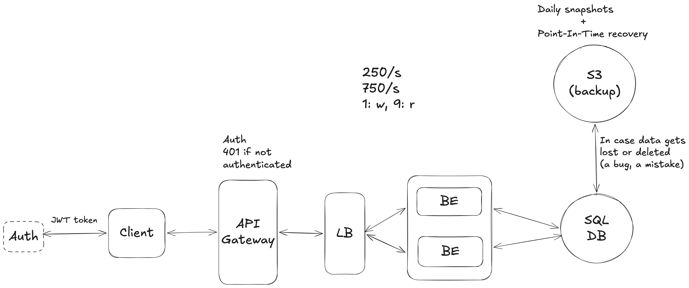

# Bookmarks manager – design

## Problem

Design a bookmarks manager. People find links online (articles, docs, videos)
and want to save them and find them again later, from any device.

### Clarifications

- Standalone web app, used in any browser (not a browser extension)
- Users paste a URL into the app; one-click saving is out of scope
- We store the link only, not the page content or files
- Folders are one level only (no folders inside folders)

## Functional requirements

Users should be able to:

- Create folders: one level
- Save a URL: with a name in a folder
- View the bookmarks in a folder
- Search bookmarks (by name)
- Edit or delete a bookmark

## Non-functional requirements

The system should be:

- Fast: save bookmarks and search for them in about 500ms
- Highly available (fault tolerance) when failure happens
- Secure (users data and user A should not read userB bookmarks or data)
- Durable: data is not lost
- Scalable when traffic spikes happens (seasons, events) --> 10 million registred users, 1 million of them active on a given day (spikes: 3 times the normal level)

## Core entities

User, Folder, Bookmark

Full data model: [data-model.md](data-model.md)

## API

- POST /folders
- POST /bookmarks
- GET /folders
- GET /folders/:folderId/bookmarks?sort=…&limit=…&offset=…
- GET /bookmarks?name=…
- PUT /bookmarks/:bookmarkId
- DELETE /bookmarks/:bookmarkId

Full details: [api.md](api.md)

## Capacity estimates

- Normal: 250 requests/second
- Peak (3x): 750 requests/second
- Writes vs reads: 1 out of 10 are write requests

What this changes in the design:

- One backend instance and one Postgres can handle the load even at peak, so no cache and no sharding.
- The second backend instance and the standby database are there for availability, not for load.

## Retries and idempotency

### Problem

**Q: What happens when the client sends POST /bookmarks, the bookmark is saved, but the response is lost?**
A: The client can't tell whether it worked, so it retries. The retry hits the unique rule and gets 409, even though the first request succeeded.

### Decision

**Q: Which header does the client send, and when is the key new or reused?**
A: `Idempotency-Key: <uuid>`. The client makes a new key for each create action (each click on Save) and reuses the same key for every retry of that action.

**Q: What does the server save, and what does it send back on a retry?**
A: It saves the key with the response it sent (status and body). On a retry with the same key, it sends that saved response again and creates nothing.

**Q: What if the same key comes back with a different body?**
A: It's a client bug, so the server refuses with 422 `IDEMPOTENCY_KEY_REUSED`. A hash of the body is saved with the key to detect this.

**Q: Who does a key belong to?**
A: One user. Keys are unique per user, so two users who happen to send the same key never see each other's response.

**Q: Is the header required?**
A: No. Without it, the endpoint works as before.

### Trade-offs

**Q: How long are keys kept?**
A: 24 hours. Retries happen within seconds or minutes, so a day is plenty, and the table stays small.

**Q: Which endpoints get it?**
A: Only POST /bookmarks for now. POST /folders can be added the same way later. PUT and DELETE don't need it: repeating them gives the same result.
